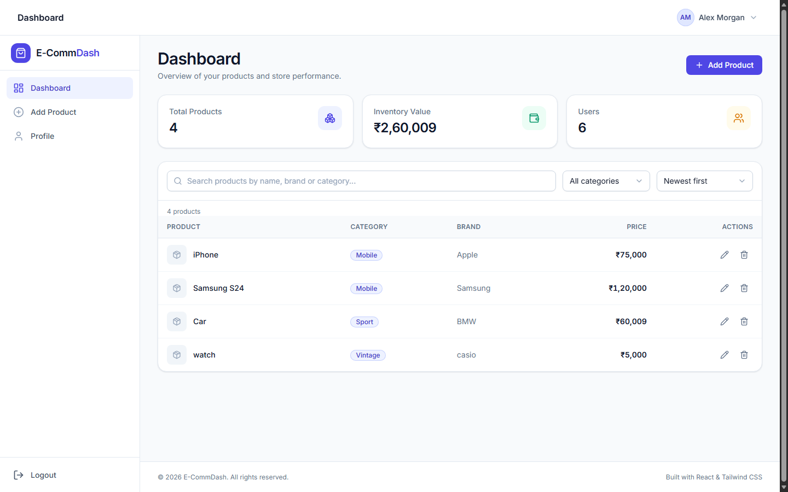
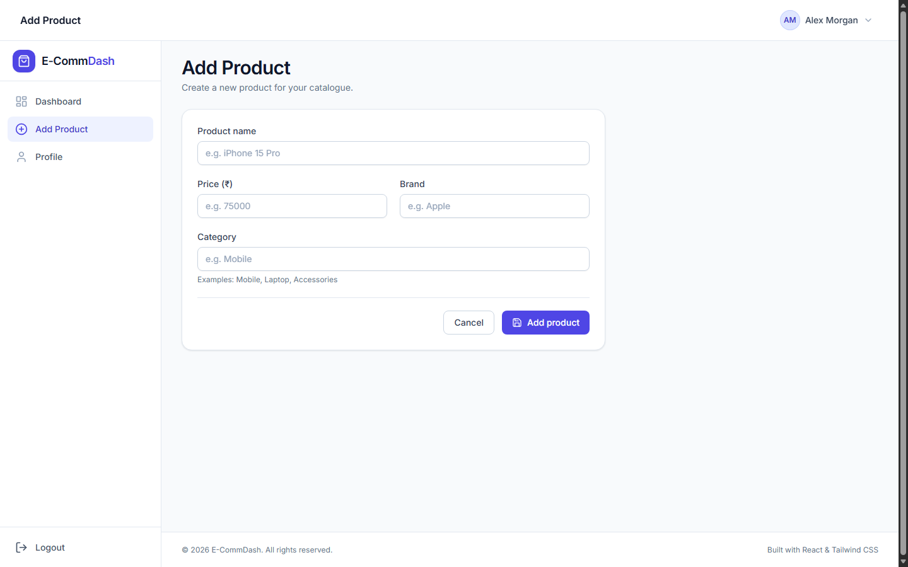
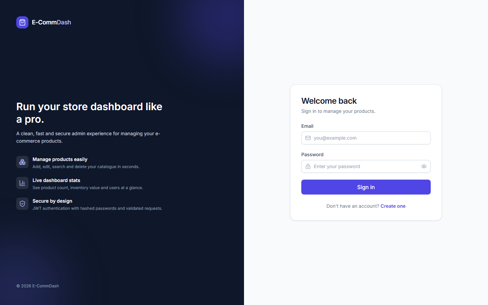

# 🛒 MERN E-commerce Dashboard

[](https://github.com/sumitsg0509/Mern-ecommerce-dashboard/actions/workflows/ci.yml)

A full-stack **MERN dashboard** for managing an e-commerce product catalogue. Users can register, log in, and add, edit, search, filter, and delete products from a clean, responsive admin interface.

---

## ✨ Highlights

- 🔐 **Secure authentication** — bcrypt password hashing + JWT-protected API routes
- 🎨 **Professional responsive UI** — Tailwind CSS design system, Inter font, `lucide-react` icons, toasts, modals, skeleton loaders
- 📊 **Live dashboard** — product count, inventory value, user count, search, category filter, sorting, and pagination
- ✅ **Validated API** — Zod schemas, centralized error handling, rate limiting, Helmet, and a CORS whitelist
- 🧪 **Tested** — 61 Jest + Supertest integration tests against an isolated test database
- ⚙️ **CI/CD ready** — GitHub Actions runs backend tests and the frontend production build on every push/PR

---

## 🚀 Features

### Frontend

- Responsive app shell with sidebar navigation, navbar, and footer
- Login and registration screens with inline validation and password visibility toggle
- Dashboard stats cards, debounced search, category filter, sorting, and pagination
- Add and edit product forms with client-side validation
- Delete confirmation modal, toast notifications, empty states, and skeleton loaders
- Profile page, 404 page, and protected routing with automatic logout on expired tokens
- Centralized API layer (`src/api.js`) with JWT injection and normalized errors

### Backend

- User registration and login with bcrypt + JWT
- Protected product CRUD, search, dashboard stats, and user count
- Zod request validation (strips unknown fields and blocks operator injection)
- Centralized error handler with consistent JSON error responses
- Helmet security headers, CORS whitelist, and rate limiting
- Environment-based configuration via `.env`

---

## 🛠 Tech Stack

| Layer          | Technologies                                                           |
| -------------- | ---------------------------------------------------------------------- |
| **Frontend**   | React 19, React Router 7, Tailwind CSS 3, lucide-react, Inter          |
| **Backend**    | Node.js, Express 5, JWT, bcryptjs, Zod 4, Helmet, express-rate-limit   |
| **Database**   | MongoDB, Mongoose 9                                                    |
| **Testing**    | Jest 30, Supertest 7                                                   |
| **CI**         | GitHub Actions (MongoDB service container)                             |

---

## 📂 Project Structure

```text
.
├── Backend
│   ├── src
│   │   ├── config        env validation + MongoDB connection
│   │   ├── controllers   auth, product, stats
│   │   ├── middleware    auth, validation, rate limiting, error handling
│   │   ├── models        User, Product
│   │   ├── routes        auth, product, stats
│   │   ├── utils         ApiError, asyncHandler, token, escapeRegex
│   │   └── validators    auth, product
│   ├── tests             API integration tests
│   │   └── helpers       test database + auth helpers
│   ├── index.js          server entry point
│   ├── jest.config.js
│   ├── .env.example
│   └── package.json
│
├── front-end
│   ├── public
│   ├── src
│   │   ├── components
│   │   │   ├── auth        AuthLayout
│   │   │   ├── layout      AppShell, Navbar, Sidebar, Footer
│   │   │   ├── products    StatsCards, ProductTable, ProductCards, ProductForm
│   │   │   ├── ui          Button, Input, Select, Modal, Card, Badge, etc.
│   │   │   └── Protected.js
│   │   ├── context
│   │   │   └── ToastContext.jsx
│   │   ├── pages           Login, SignUp, Dashboard, AddProduct, UpdateProduct, Profile, NotFound
│   │   ├── utils           auth + formatting helpers
│   │   ├── api.js          centralized API client
│   │   ├── App.js
│   │   └── index.js
│   ├── .env.example
│   └── package.json
│
├── screenshots
├── .github/workflows/ci.yml
└── README.md
```

---

## ⚙️ Getting Started

### Prerequisites

- Node.js **20.19+**
- npm
- MongoDB running locally, or a MongoDB Atlas connection string
- Git

### 1. Clone the repository

```bash
git clone https://github.com/sumitsg0509/Mern-ecommerce-dashboard.git
cd Mern-ecommerce-dashboard
```

### 2. Configure the backend

```bash
cd Backend
npm install
cp .env.example .env
```

Fill in `Backend/.env`:

```env
NODE_ENV=development
PORT=5000
MONGO_URI=mongodb://127.0.0.1:27017/ecomm
JWT_SECRET=replace-with-a-long-random-secret
JWT_EXPIRES_IN=2h
CLIENT_ORIGIN=http://localhost:3000
```

> Generate a strong secret with `node -e "console.log(require('crypto').randomBytes(32).toString('hex'))"`.

### 3. Start the backend

```bash
npm run dev
```

Server: `http://localhost:5000`

> **Port already in use?** Change `PORT` in `Backend/.env` (for example to `5001`) and set the matching `REACT_APP_API_URL` in `front-end/.env` (for example `http://localhost:5001`). Restart both servers after changing env files.

### 4. Configure and start the frontend

```bash
cd ../front-end
npm install
cp .env.example .env
npm start
```

App: `http://localhost:3000`

> If you previously ran the app against an older API URL, restart the dev server so the new `REACT_APP_API_URL` is picked up.

### 5. Create an account

Open `http://localhost:3000`, go to **Create one**, and register a new account. Accounts created before bcrypt hashing was introduced must be re-registered.

---

## 🔧 Environment Variables

### Backend (`Backend/.env`)

| Variable         | Required | Default                              | Description                              |
| ---------------- | :------: | ------------------------------------ | ---------------------------------------- |
| `NODE_ENV`       |    No    | `development`                        | Runtime environment                      |
| `PORT`           |    No    | `5000`                               | API port                                 |
| `MONGO_URI`      |   Yes    | —                                    | MongoDB connection string                |
| `JWT_SECRET`     |   Yes    | —                                    | Secret used to sign JWTs                 |
| `JWT_EXPIRES_IN` |    No    | `2h`                                 | Token lifetime (e.g. `2h`, `7d`)         |
| `CLIENT_ORIGIN`  |    No    | `http://localhost:3000`              | Allowed CORS origin(s), comma-separated  |

### Frontend (`front-end/.env`)

| Variable            | Required | Default                 | Description                    |
| ------------------- | :------: | ----------------------- | ------------------------------ |
| `REACT_APP_API_URL` |    No    | `http://localhost:5000` | Backend base URL (no `/api`)   |

---

## 📜 Available Scripts

### Backend (`cd Backend`)

| Script                 | Description                              |
| ---------------------- | ---------------------------------------- |
| `npm start`            | Start the API with Node                  |
| `npm run dev`          | Start with nodemon (auto-restart)        |
| `npm test`             | Run the integration test suite           |
| `npm run test:watch`   | Run tests in watch mode                  |
| `npm run test:coverage`| Run tests with a coverage report         |

### Frontend (`cd front-end`)

| Script          | Description                             |
| --------------- | --------------------------------------- |
| `npm start`     | Start the development server            |
| `npm run build` | Create an optimized production build    |
| `npm test`      | Run the test suite (watch mode)         |

---

## 🌐 API Routes

Base URL: `http://localhost:5000` (routes are mounted at the root, not under `/api`).

| Method | Route          | Auth | Description               |
| ------ | -------------- | :--: | ------------------------- |
| POST   | `/register`     |  ❌  | Register a user           |
| POST   | `/login`        |  ❌  | Log in and receive a JWT  |
| GET    | `/products`     |  ✅  | List all products         |
| POST   | `/add-product`  |  ✅  | Create a product          |
| GET    | `/product/:id`  |  ✅  | Get one product           |
| PUT    | `/product/:id`  |  ✅  | Update a product          |
| DELETE | `/product/:id`  |  ✅  | Delete a product          |
| GET    | `/search/:key`  |  ✅  | Search name/brand/category|
| GET    | `/stats`        |  ✅  | Dashboard totals          |
| GET    | `/users/count`  |  ✅  | Total user count          |

Protected routes require:

```http
Authorization: Bearer <token>
```

### Response shapes

```jsonc
// POST /login
{ "user": { "_id": "...", "name": "...", "email": "..." }, "auth": "<jwt>" }

// Error
{ "success": false, "message": "Invalid email or password" }
```

---

## 🧪 Testing

### Backend (Jest + Supertest)

The API suite runs against a separate **`ecomm_test`** database, so development data is never touched. The test helper refuses to run against a database whose name does not contain `test`.

```bash
cd Backend
npm test              # run once
npm run test:watch    # watch mode
npm run test:coverage # coverage report
```

Current status: **61 tests across 4 suites**, with ~96% statement / ~96% line coverage.

Covered areas include registration and login, password hashing, duplicate emails, JWT expiry, deleted users, validation failures, operator-injection attempts, full product CRUD, search escaping, stats, 404s, malformed JSON, and CORS.

> MongoDB must be running locally. Override the test database with `MONGO_URI=...` (its name must contain `test`).

### Frontend

```bash
cd front-end
npm test -- --watchAll=false
npm run build
```

### Continuous Integration

`.github/workflows/ci.yml` runs on every push and pull request to `main`/`master`:

- **Backend** — installs dependencies, starts a `mongo:7` service container, runs `npm run test:coverage`, and uploads the coverage report
- **Frontend** — installs dependencies, runs the test suite, and creates a production build

Both jobs use Node.js 20 with npm caching.

---

## ☁️ Deployment

### Database

Create a free cluster on **MongoDB Atlas** and allow access from your backend host. Use the SRV connection string as `MONGO_URI`.

### Backend (Render / Railway / Fly.io)

1. Set the root directory to `Backend`
2. Build command: `npm install`
3. Start command: `npm start`
4. Add `MONGO_URI`, `JWT_SECRET`, `JWT_EXPIRES_IN`, `CLIENT_ORIGIN`, and `NODE_ENV=production`

### Frontend (Vercel / Netlify)

1. Set the root directory to `front-end`
2. Build command: `npm run build`
3. Output directory: `build`
4. Add `REACT_APP_API_URL=https://your-backend-url` **before** building

> `REACT_APP_*` variables are baked in at build time, so redeploy the frontend whenever the API URL changes.

---

## 📸 Screenshots

### Product List



### Add Product



### Login Page



---

## ⚠️ Known Limitations

- Accounts created before bcrypt hashing was enforced must re-register.
- Products are shared across all authenticated users; there is no per-user ownership or admin role yet.
- JWTs are stored in `localStorage`; there are no refresh tokens or server-side revocation.
- Stats are computed on request rather than cached.

### Roadmap

- [ ] Admin/user roles and ownership checks
- [ ] Pagination and filtering on the server (currently client-side)
- [ ] Refresh tokens and token revocation
- [ ] Image uploads for products
- [ ] Docker Compose setup for one-command local development

---

## 👨‍💻 Author

**Sumit**

MSc Computer Science Student
MERN Stack Learner 🚀

---

## ⭐ Support

If you like this project, please give it a ⭐ on GitHub.
